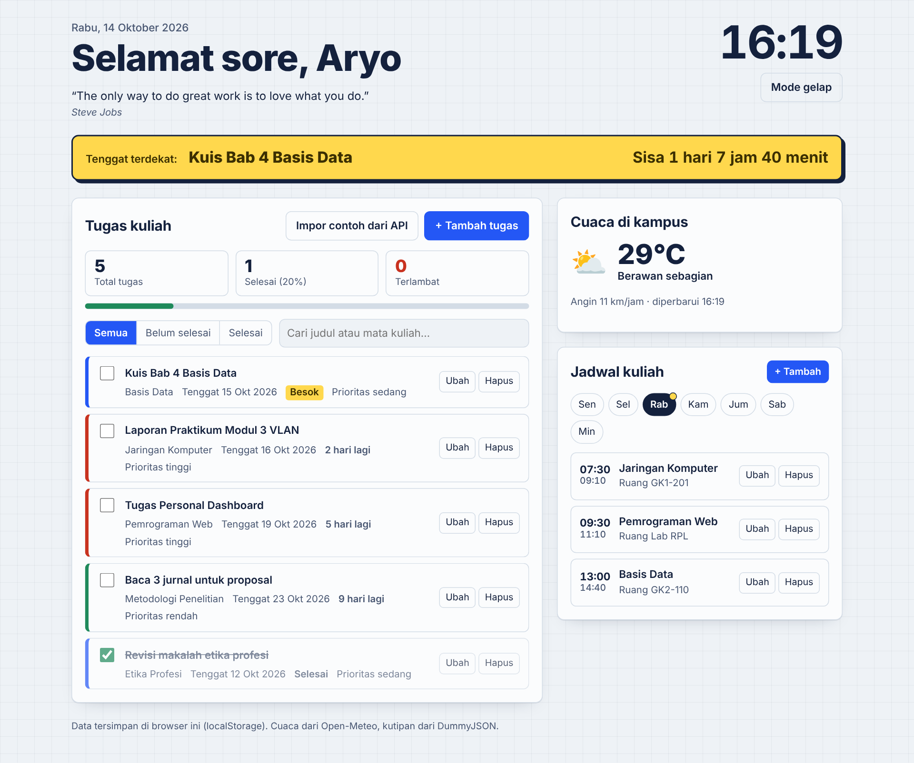
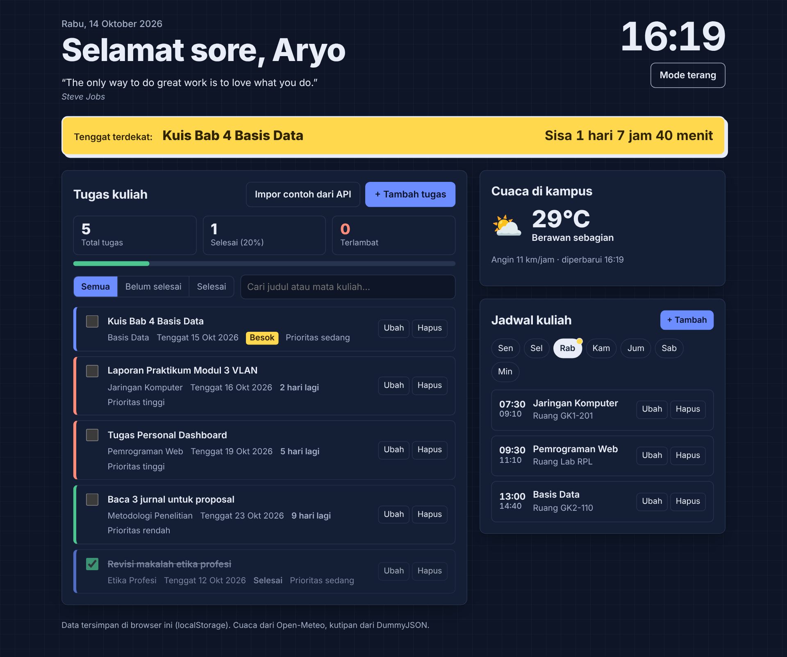
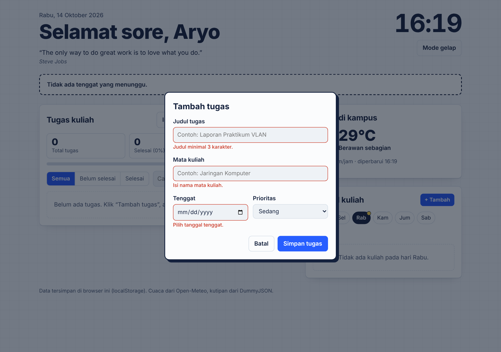
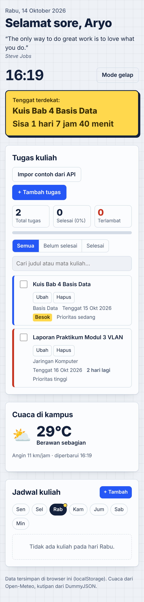

# Dashboard Kuliah

Tugas Praktikum Pertemuan 2 – Personal Dashboard (JavaScript ES6+)

| | |
|---|---|
| **Nama** | Aryo Fajar Pratomo |
| **NIM** | 124140012 |
| **Kelas Praktikum** | RA |
| **Mata Kuliah** | Pemrograman Aplikasi Web – Teknik Informatika, Institut Teknologi Sumatera |

## Fungsi Aplikasi

**Dashboard Kuliah** membantu mahasiswa memantau tugas dan jadwal kuliah dalam satu halaman. Bagian atas selalu menampilkan **tugas dengan tenggat terdekat beserta hitung mundurnya** (hari, jam, menit), sehingga jelas apa yang harus dikerjakan lebih dulu. Seluruh data tersimpan di browser (`localStorage`), jadi tidak hilang saat halaman ditutup atau di-refresh.

Dibuat dengan HTML, CSS, dan JavaScript murni (tanpa framework maupun library).

## Fitur

**Tugas kuliah (tambah, ubah, hapus)**
- Tambah dan ubah tugas lewat form: judul, mata kuliah, tenggat, dan prioritas (rendah / sedang / tinggi)
- Validasi form dengan pesan error di bawah input yang salah
- Centang tugas untuk menandai selesai, hapus dengan konfirmasi
- Filter *Semua / Belum selesai / Selesai* dan pencarian berdasarkan judul atau mata kuliah
- Daftar otomatis terurut berdasarkan tenggat, tugas yang selesai dipindah ke bawah
- Label tenggat otomatis: *Hari ini*, *Besok*, *3 hari lagi*, *Terlambat 2 hari*
- Statistik: total tugas, selesai (persen dan progress bar), dan terlambat
- Tombol **Impor contoh dari API** untuk mengisi 5 tugas awal dari JSONPlaceholder

**Jadwal kuliah (tambah, ubah, hapus)**
- Pilih hari Senin sampai Minggu, hari ini diberi penanda titik kuning
- Kuliah yang sedang berlangsung disorot
- Validasi: jam selesai harus setelah jam mulai

**Informasi harian (async)**
- Cuaca real-time kampus ITERA dari Open-Meteo, dengan tombol muat ulang bila gagal
- Kutipan harian dari DummyJSON; bila offline diganti kalimat bawaan

**Lainnya**
- Jam digital, tanggal, dan sapaan sesuai waktu (pagi / siang / sore / malam)
- Mode terang dan gelap; pilihan tersimpan (kunjungan pertama mengikuti pengaturan sistem)
- Responsif sampai layar ponsel, fokus keyboard terlihat, mendukung `prefers-reduced-motion`
- Teks dari pengguna di-*escape* sebelum masuk `innerHTML` (aman dari injeksi HTML)
- Data `localStorage` yang rusak disaring, sehingga aplikasi tidak error

## Cara Menjalankan

1. Buka folder `Tugas Personal Dashboard` di VS Code.
2. Klik kanan `index.html`, pilih **Open with Live Server** (atau klik dua kali `index.html`).
3. Hubungkan ke internet agar cuaca, kutipan, dan impor contoh tugas berfungsi.

## Struktur Folder

```
aryofajarpratomo_124140012_pertemuan2/
├── SS/                          # Tangkapan layar
├── modul/                       # Praktikum modul (project-js-nextgen)
└── Tugas Personal Dashboard/
    ├── index.html               # Struktur halaman dan dialog form
    ├── style.css                # Tampilan (tema terang/gelap, responsif)
    ├── script.js                # Logika: class TaskItem, ScheduleItem, DashboardApp
    └── README.md
```

## Tangkapan Layar

**1. Tampilan utama**



**2. Mode gelap**



**3. Validasi form**



**4. Tampilan di ponsel**



## Fitur ES6+ yang Diimplementasikan

Nomor baris mengacu pada `script.js`.

| Fitur ES6+ | Penerapan | Baris |
|---|---|---|
| `const` | Konfigurasi tetap (`KEYS`, `API`, `NAMA_HARI`, `URUTAN_HARI`, `KODE_CUACA`) dan semua fungsi helper; juga dipakai di dalam method | 3–60 |
| `let` | `dueClass` pada template tugas, nilainya berubah sesuai kondisi tenggat | 380 |
| Arrow function (helper) | `$`, `pad`, `uid`, `esc`, `toISODate`, `addDays`, `startOfToday`, `formatDate`, `formatCountdown` (9 fungsi) | 32–60 |
| Arrow function (callback) | `map`, `filter`, `sort`, dan event listener di seluruh class | 219–237, 289–290, 309–319, 423–446, 566–655 |
| Template literals (HTML) | Rendering dinamis: cuaca, kutipan, tenggat terdekat, statistik, daftar tugas, jadwal | 254–276, 356–375, 383–409, 426–442 |
| Template literals (string) | Hitung mundur, label tenggat, format tanggal dan jam, sapaan, pesan konfirmasi dan toast | 34, 39, 51, 59, 79, 92–100, 124, 297, 336, 344, 597, 625 |
| **Async/Await** | `fetchJSON`, `loadWeather`, `loadQuote`, `importSampleTasks` memakai `fetch()` dengan `try/catch/finally` | 242–304 |
| `Promise.allSettled` | Cuaca dan kutipan dimuat bersamaan saat aplikasi dibuka | 658 |
| Classes | `TaskItem` (model tugas), `ScheduleItem` (model jadwal), `DashboardApp` (state, localStorage, fetch, render) | 66–111, 113–135, 141–660 |
| Getter dan `static` | `dueDate`, `msLeft`, `isOverdue`, `dayDiff`, `dueLabel`; `TaskItem.isValid`, `ScheduleItem.isValid` | 78–111, 132–134 |
| Destructuring | Parameter `constructor({...})`, `validateTask({...})`, event `({ target })`, hasil `fetch` `{ quote, author }`, array `[icon, desc]`, `const { tasks, filter, query } = this.state` | 67, 114, 251–252, 273, 309, 379, 470, 478, 523, 543, 576 |
| Default parameter | `root = document`, `id = uid()`, `priority = 'sedang'`, `room = ''`, `now = new Date()` | 32, 67, 114, 123 |
| Spread operator | Update state tanpa mutasi: `{ ...this.state, ...changes }`, `[...tasks, task]`, `{ ...this, ...changes }` | 105, 129, 206, 215, 229, 295, 505, 514 |
| Optional chaining dan `??` | `window.matchMedia?.()`, `KODE_CUACA[...] ?? [...]`, `errors[...] ?? ''` | 201, 252, 489 |
| `Set`, `Object.entries`, `Object.fromEntries` | Cegah impor ganda, isi form, baca `FormData` | 287, 497, 523, 543 |
| `String.prototype.padStart` | Format jam dan tanggal dua digit | 33 |

## Penjelasan Teknis Singkat

**Arsitektur.** `TaskItem` dan `ScheduleItem` hanya memodelkan data. `DashboardApp` memegang `state` (daftar tugas, jadwal, filter, pencarian, hari terpilih, tema), dan semua perubahan lewat satu pintu, `setState()`, yang membuat objek state baru (immutable) lalu menyimpannya ke `localStorage`.

**localStorage.** Kunci yang dipakai: `dashboard.tasks`, `dashboard.schedule`, dan `dashboard.theme`. Data ditulis dengan `JSON.stringify()` dan dibaca dengan `JSON.parse()` di dalam `try/catch`. Setiap item divalidasi lewat `isValid()` lalu dibentuk ulang menjadi instance class-nya.

**Operasi asinkron.** Semua pemanggilan API memakai `async/await`. Jika jaringan gagal, aplikasi tetap berjalan: cuaca menampilkan tombol muat ulang, kutipan diganti kalimat bawaan, dan impor menampilkan pesan.

**Sumber API (gratis, tanpa API key).**
- Cuaca: `https://api.open-meteo.com/v1/forecast?latitude=-5.36&longitude=105.31&current_weather=true`
- Kutipan: `https://dummyjson.com/quotes/random`
- Contoh tugas: `https://jsonplaceholder.typicode.com/todos?_limit=5`
