# Manajemen Buku

Tugas Praktikum Pemrograman Web Pertemuan 3 (React Basics)  
**Aryo Fajar Pratomo – 124140012**

## Deskripsi Aplikasi

Manajemen Buku adalah aplikasi web untuk mencatat koleksi buku pribadi. Setiap buku memiliki judul, penulis, dan salah satu dari tiga status:

- **Dimiliki** – buku yang sudah dimiliki
- **Sedang Dibaca** – buku yang sedang dibaca
- **Ingin Dibeli** – daftar keinginan

Data disimpan di `localStorage`, jadi koleksi tetap ada walaupun browser di-refresh atau ditutup.

### Fitur

- Menambah buku baru dengan validasi form (kolom kosong diberi border merah dan pesan error)
- Mengedit buku (form berubah menjadi mode **Edit Buku**) dan menghapus buku dengan konfirmasi
- Filter berdasarkan status, lengkap dengan jumlah buku per status
- Pencarian berdasarkan judul atau nama penulis (tidak membedakan huruf besar/kecil)
- Notifikasi singkat setelah menambah, mengedit, atau menghapus
- Halaman **Statistik**: total buku, jumlah dan persentase per status, penulis terbanyak, dan buku terakhir ditambahkan
- Halaman 404 untuk alamat yang tidak dikenal
- Tampilan responsif untuk layar ponsel

## Instalasi dan Cara Menjalankan

Prasyarat: Node.js 18 atau lebih baru.

1. Buka folder `Manajemen Buku` di VS Code, lalu buka terminal (**Ctrl + `**).
2. Pasang dependensi:
   ```bash
   npm install
   ```
3. Jalankan aplikasi:
   ```bash
   npm run dev
   ```
   Buka alamat yang muncul di terminal (biasanya `http://localhost:5173`).
4. Jalankan unit test:
   ```bash
   npm test              # ringkas
   npm run test:verbose  # menampilkan nama setiap test
   ```

## Screenshot Antarmuka

| No | Tampilan | Screenshot |
|----|----------|------------|
| 1 | Koleksi masih kosong | 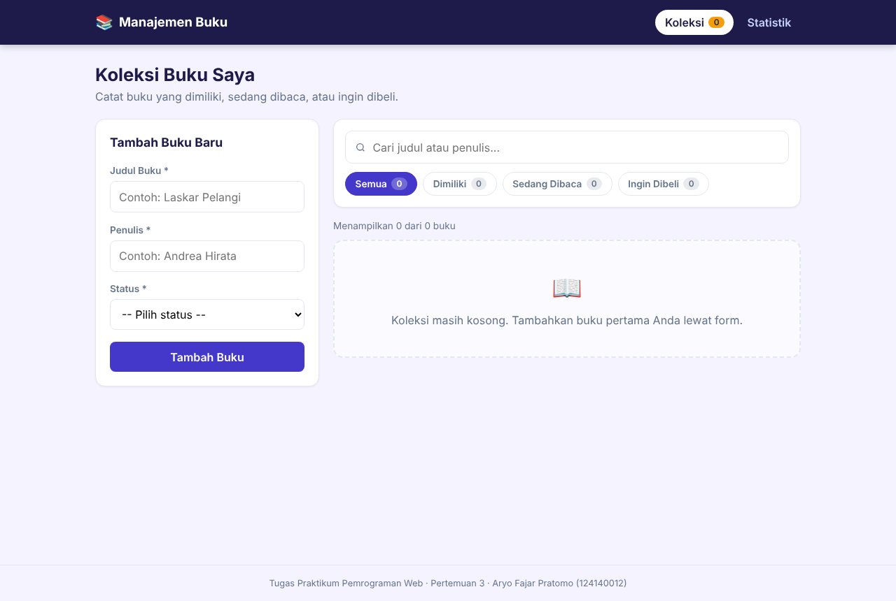 |
| 2 | Validasi form kosong | 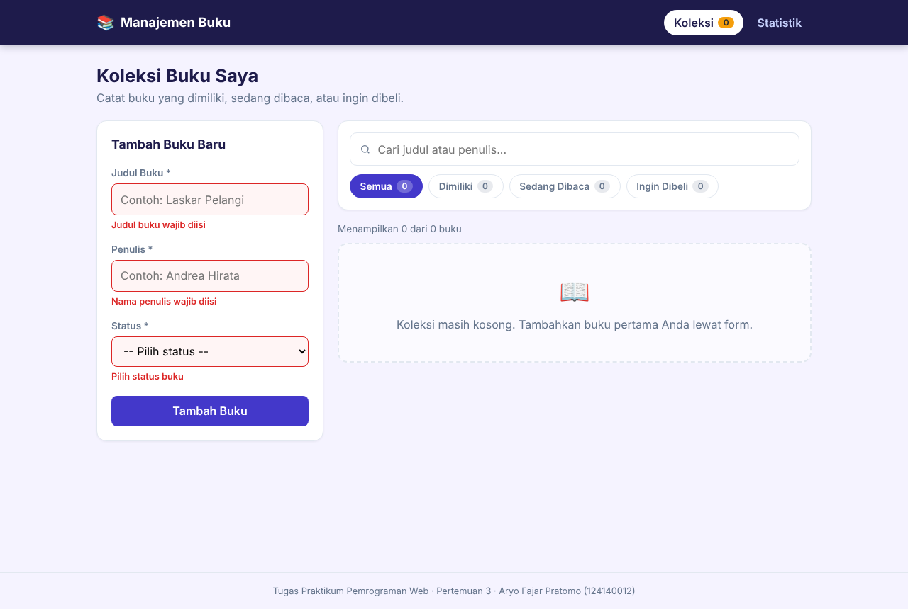 |
| 3 | Buku berhasil ditambahkan | 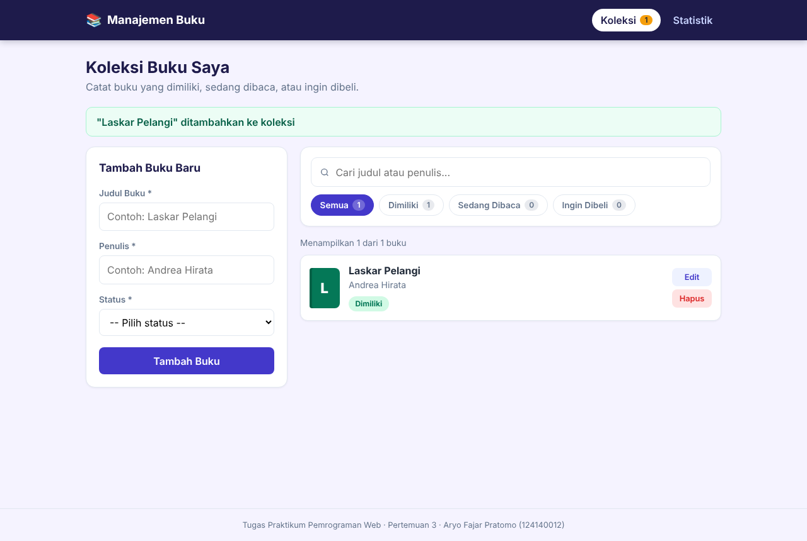 |
| 4 | Daftar koleksi buku | 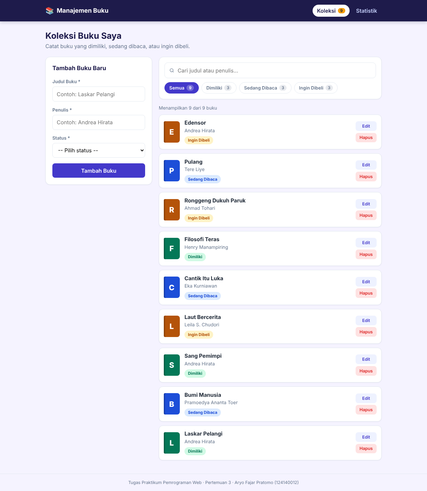 |
| 5 | Filter status "Sedang Dibaca" | 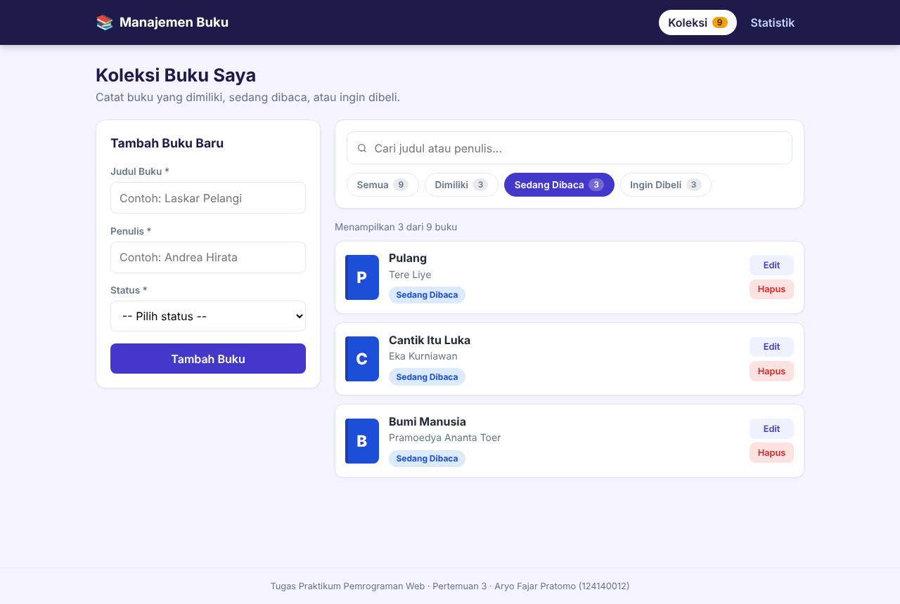 |
| 6 | Pencarian judul atau penulis | 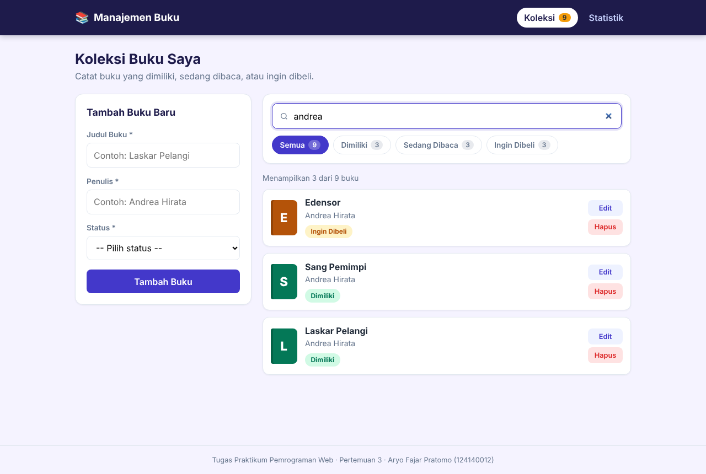 |
| 7 | Mode edit buku | 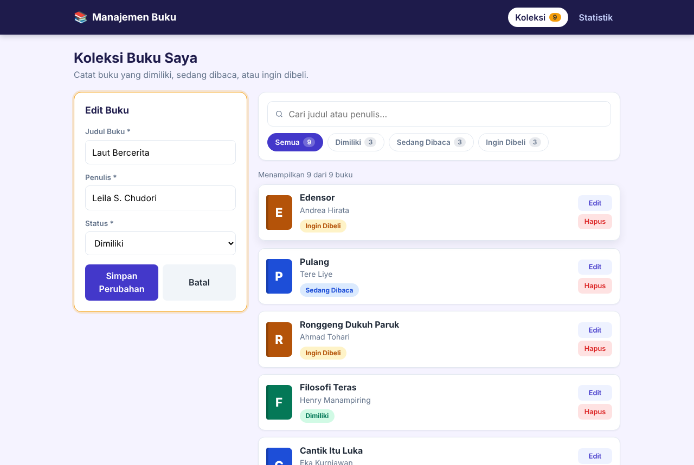 |
| 8 | Perubahan tersimpan | 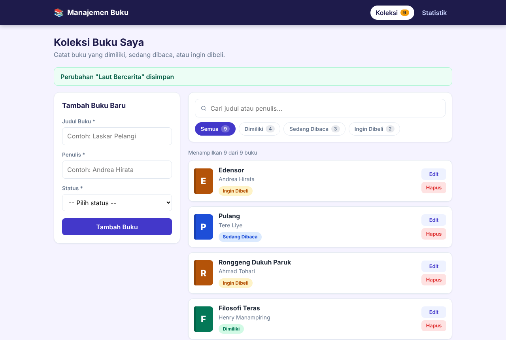 |
| 9 | Buku dihapus | 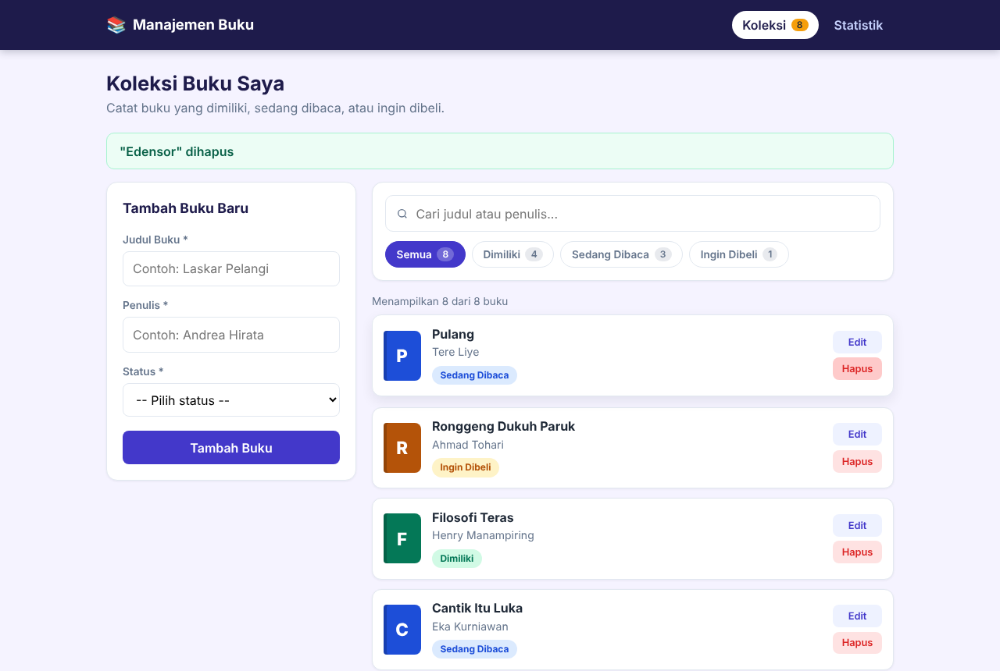 |
| 10 | Data tetap ada setelah refresh (localStorage) | 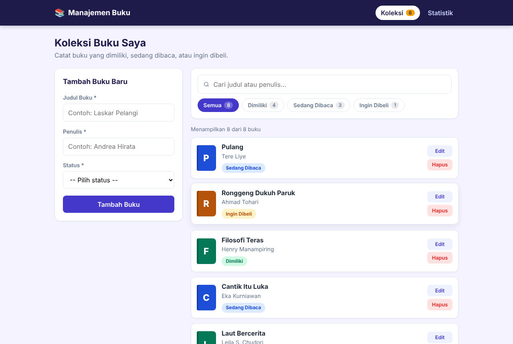 |
| 11 | Halaman statistik | 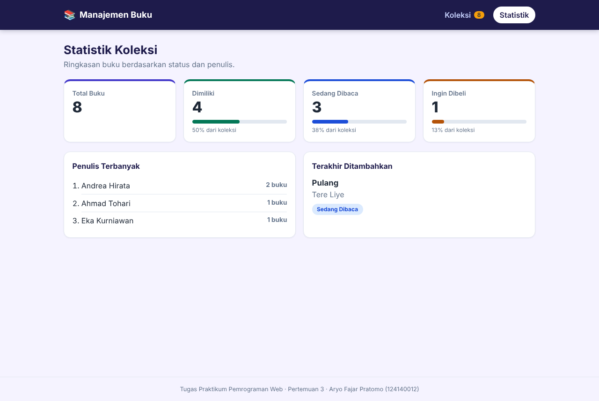 |
| 12 | Halaman 404 | 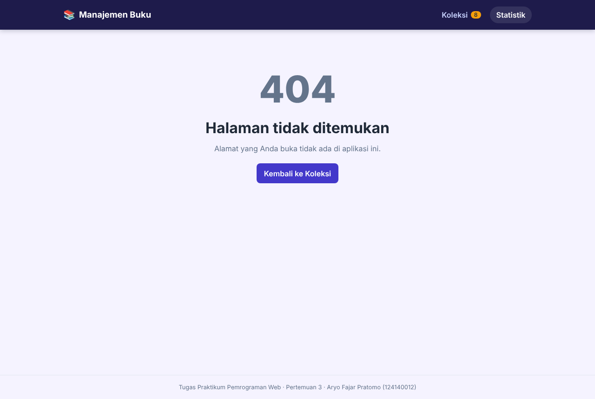 |
| 13 | Tampilan ponsel | 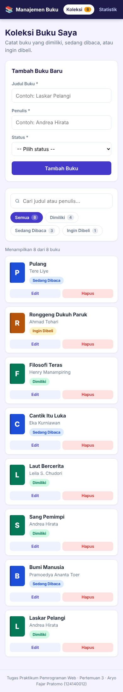 |
| 14 | Hasil unit test (23 test lulus) | 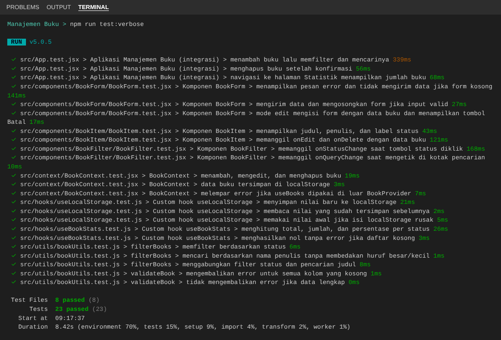 |

## Penjelasan Fitur React yang Digunakan

| Konsep | Penerapan |
|--------|-----------|
| **Functional component** | Semua komponen ditulis sebagai fungsi |
| **useState** | Form (`BookForm`), filter, kata kunci pencarian, buku yang sedang diedit, dan notifikasi (`Home`) |
| **useEffect** | Menyimpan data ke `localStorage` (`useLocalStorage`), memperbarui judul tab dengan jumlah buku, dan menghapus notifikasi otomatis dengan timer yang dibersihkan (`Home`) |
| **useMemo** | Statistik hanya dihitung ulang saat daftar buku berubah (`useBookStats`) |
| **Komponen reusable** | `BookForm` (mode tambah dan edit), `BookList`, `BookItem`, `BookFilter`, `StatusBadge`, `StatCard`, `Navbar` |
| **Custom hook** | `useLocalStorage` (state yang tersimpan otomatis) dan `useBookStats` (jumlah, persentase, penulis terbanyak, buku terbaru) |
| **Context API** | `BookContext` menyediakan `books`, `addBook`, `updateBook`, `deleteBook` untuk semua halaman tanpa prop drilling; `useBooks()` melempar error jika dipakai di luar `BookProvider` |
| **React Router** | `BrowserRouter`, `Routes`, `Route` untuk `/`, `/stats`, dan `*` (404); `NavLink` menandai menu aktif |
| **PropTypes** | Setiap komponen yang menerima props memiliki `propTypes` |
| **Key pada list** | `BookList` memakai `key={book.id}` |
| **Validasi form** | `validateBook()` memeriksa judul, penulis, dan status; input yang salah diberi class `input-error`, `aria-invalid`, dan pesan error |

## Struktur Folder

```
src/
├── components/
│   ├── BookFilter/   BookFilter.jsx, BookFilter.css, BookFilter.test.jsx
│   ├── BookForm/     BookForm.jsx, BookForm.css, BookForm.test.jsx
│   ├── BookItem/     BookItem.jsx, BookItem.css, BookItem.test.jsx
│   ├── BookList/     BookList.jsx, BookList.css
│   ├── Navbar/       Navbar.jsx, Navbar.css
│   ├── StatCard/     StatCard.jsx, StatCard.css
│   └── StatusBadge/  StatusBadge.jsx, StatusBadge.css
├── context/
│   ├── BookContext.jsx
│   └── BookContext.test.jsx
├── hooks/
│   ├── useLocalStorage.js   (+ test)
│   └── useBookStats.js      (+ test)
├── pages/
│   ├── Home/       Home.jsx, Home.css
│   ├── Stats/      Stats.jsx, Stats.css
│   └── NotFound/   NotFound.jsx, NotFound.css
├── utils/
│   ├── bookUtils.js         STATUS_OPTIONS, filterBooks, validateBook
│   └── bookUtils.test.js
├── App.jsx
├── App.test.jsx             uji integrasi alur pengguna
├── index.css
├── main.jsx
└── setupTests.js
```

## Laporan Testing

Testing memakai **Vitest + React Testing Library**. Total **23 test di 8 berkas, semuanya lulus** (screenshot nomor 14).

| Berkas | Yang diuji |
|--------|------------|
| `utils/bookUtils.test.js` | Filter status, pencarian penulis tanpa beda huruf besar/kecil, gabungan filter, validasi form |
| `components/BookForm/BookForm.test.jsx` | Error saat form kosong, kirim data valid, mode edit dan tombol Batal |
| `components/BookFilter/BookFilter.test.jsx` | Klik filter status, ketik pencarian |
| `components/BookItem/BookItem.test.jsx` | Tampilan judul/penulis/status, tombol Edit dan Hapus |
| `hooks/useBookStats.test.js` | Perhitungan statistik dan daftar kosong |
| `hooks/useLocalStorage.test.js` | Simpan, baca, dan data localStorage yang rusak |
| `context/BookContext.test.jsx` | Tambah, edit, hapus, persistensi, dan error di luar provider |
| `App.test.jsx` | Alur lengkap: tambah, filter, cari, hapus, pindah ke halaman Statistik |
