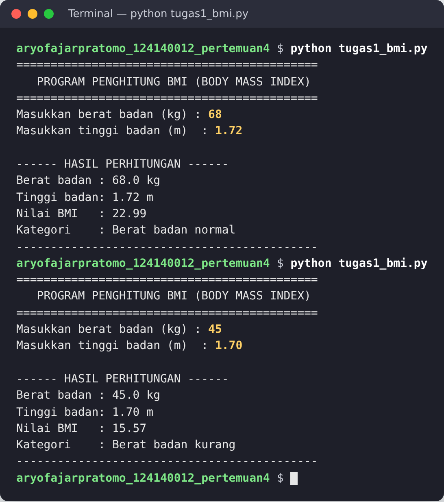
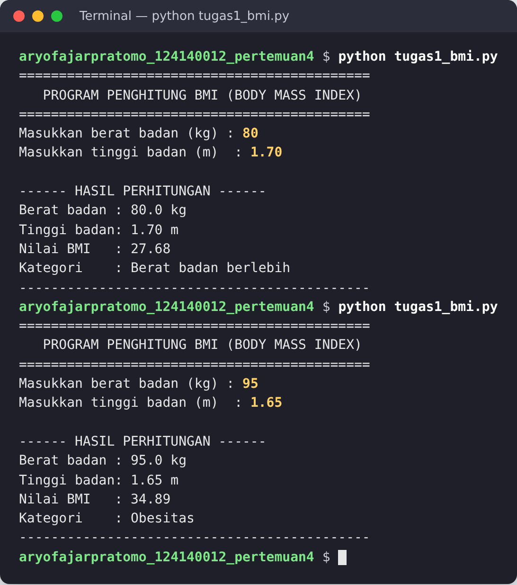
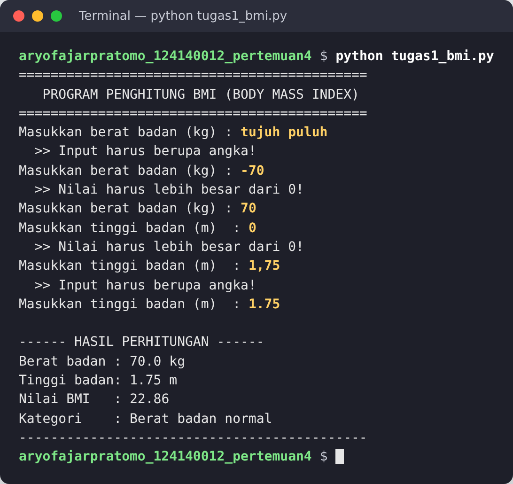
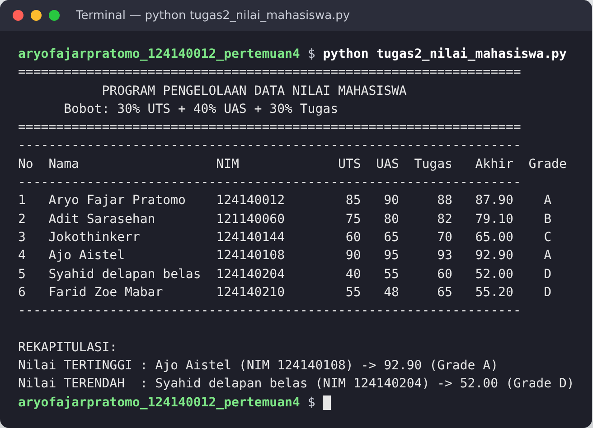
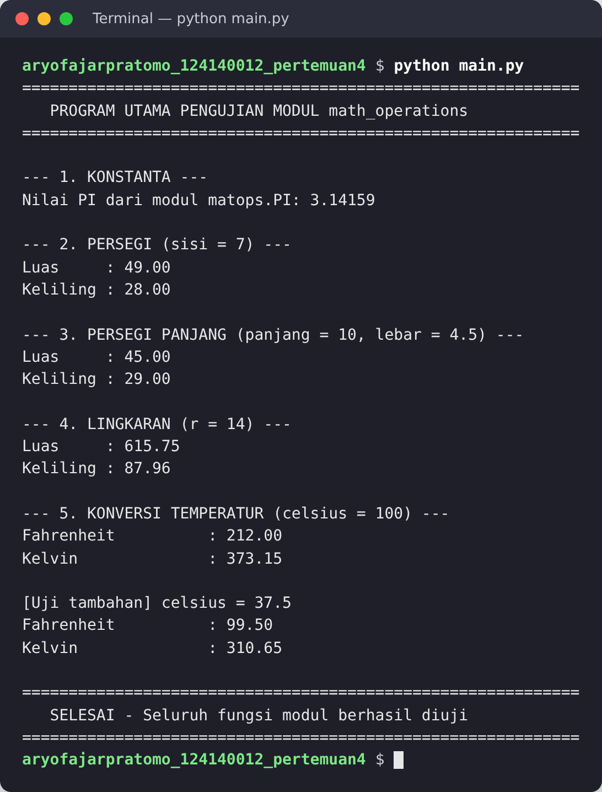
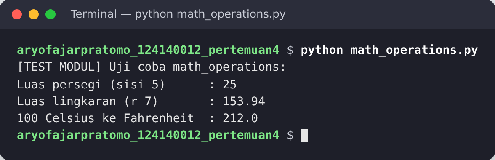
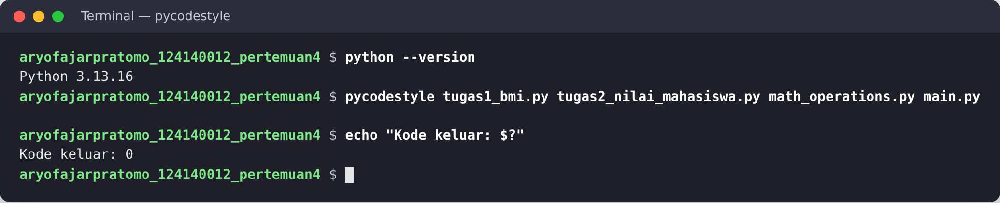

# Pertemuan 4 – Python Dasar

| | |
|---|---|
| **Nama** | Aryo Fajar Pratomo |
| **NIM** | 124140012 |
| **Kelas** | RA |
| **Mata kuliah** | Praktikum Pemrograman Web |
| **Materi** | Python dasar: variabel, struktur kendali, fungsi, struktur data, dan modul |

## Daftar Isi

1. [Struktur Folder](#1-struktur-folder)
2. [Cara Menjalankan](#2-cara-menjalankan)
3. [Tugas 1 – Penghitung BMI](#3-tugas-1--penghitung-bmi)
4. [Tugas 2 – Pengelolaan Data Nilai Mahasiswa](#4-tugas-2--pengelolaan-data-nilai-mahasiswa)
5. [Tugas 3 – Modul Matematika](#5-tugas-3--modul-matematika)
6. [Standar Kode](#6-standar-kode)

## 1. Struktur Folder

```
aryofajarpratomo_124140012_pertemuan4/
├── .gitignore                  # mengecualikan venv/ dan __pycache__/
├── README.md
├── tugas1_bmi.py               # Tugas 1
├── tugas2_nilai_mahasiswa.py   # Tugas 2
├── math_operations.py          # Tugas 3 (modul)
├── main.py                     # Tugas 3 (program utama)
├── Screenshot/                 # bukti eksekusi tugas (01–07)
├── Latihan/                    # latihan mandiri 1–6
└── Modul/                      # contoh kode dari modul praktikum
```

| Folder | Isi |
|--------|-----|
| `Latihan/` | Latihan mandiri: kartu identitas, konversi suhu, tebak angka, validasi password, katalog kontak, dan generator password. Lihat [`Latihan/README.md`](Latihan/README.md). |
| `Modul/` | Contoh kode dari modul (`01_pengenalan.py` sampai `06_modul_app.py`). Lihat [`Modul/README.md`](Modul/README.md). |
| `Screenshot/` | Tangkapan layar hasil eksekusi tugas di terminal. |

## 2. Cara Menjalankan

Pastikan Python 3.8 atau lebih baru sudah terpasang (`python --version`). Program tidak memakai paket eksternal, jadi tidak perlu `pip install`.

```bash
cd aryofajarpratomo_124140012_pertemuan4

python tugas1_bmi.py              # Tugas 1 (interaktif)
python tugas2_nilai_mahasiswa.py  # Tugas 2
python main.py                    # Tugas 3
python math_operations.py         # opsional: uji modul secara langsung
```

Di macOS/Linux, gunakan `python3` jika perintah `python` belum tersedia.

## 3. Tugas 1 – Penghitung BMI

**File:** `tugas1_bmi.py`

**Alur program:**

1. Meminta berat badan dalam **kg** dan tinggi badan dalam **meter** lewat `input()`, misalnya `1.72`.
2. `baca_angka_positif()` mengulang pertanyaan sampai input berupa angka dan lebih dari 0. Tanda desimal memakai titik; input seperti `1,75` ditolak sebagai bukan angka.
3. `hitung_bmi()` menghitung `BMI = berat / (tinggi * tinggi)`.
4. `tentukan_kategori()` menentukan kategori dengan `if-elif-else`.
5. Berat, tinggi, nilai BMI (2 angka desimal dengan f-string), dan kategori dicetak ke terminal.

| Nilai BMI | Kategori |
|-----------|----------|
| BMI < 18.5 | Berat badan kurang |
| 18.5 ≤ BMI < 25 | Berat badan normal |
| 25 ≤ BMI < 30 | Berat badan berlebih |
| BMI ≥ 30 | Obesitas |

**Hasil eksekusi:**

| Kategori normal dan kurang | Kategori berlebih dan obesitas |
|---|---|
|  |  |

Validasi input yang salah (huruf, angka negatif, nol, dan desimal memakai koma):



## 4. Tugas 2 – Pengelolaan Data Nilai Mahasiswa

**File:** `tugas2_nilai_mahasiswa.py`

**Alur program:**

1. Data 6 mahasiswa disimpan dalam **list berisi dictionary** dengan kunci `nama`, `nim`, `nilai_uts`, `nilai_uas`, dan `nilai_tugas`.
2. `hitung_nilai_akhir()` menghitung `Nilai Akhir = 30% UTS + 40% UAS + 30% Tugas`. Bobot disimpan sebagai konstanta `BOBOT_UTS`, `BOBOT_UAS`, dan `BOBOT_TUGAS`.
3. `tentukan_grade()` mengubah nilai akhir menjadi grade A–E.
4. `cetak_tabel()` mencetak tabel rapi dengan perataan f-string.
5. `cari_ekstrem()` mencari mahasiswa dengan nilai akhir tertinggi dan terendah memakai `max()` dan `min()`.

| Grade | Nilai akhir |
|-------|-------------|
| A | ≥ 80 |
| B | 70 – < 80 |
| C | 60 – < 70 |
| D | 50 – < 60 |
| E | < 50 |

**Hasil eksekusi:**



Contoh perhitungan baris pertama: 0,30 × 85 + 0,40 × 90 + 0,30 × 88 = 25,5 + 36 + 26,4 = **87,90 (A)**.

## 5. Tugas 3 – Modul Matematika

**File:** `math_operations.py` (modul) dan `main.py` (program utama)

**Isi modul `math_operations.py`:**

| Jenis | Isi |
|-------|-----|
| Konstanta | `PI = 3.14159` |
| Persegi | `luas_persegi(sisi)`, `keliling_persegi(sisi)` |
| Persegi panjang | `luas_persegi_panjang(panjang, lebar)`, `keliling_persegi_panjang(panjang, lebar)` |
| Lingkaran | `luas_lingkaran(r)`, `keliling_lingkaran(r)` |
| Konversi suhu | `celsius_ke_fahrenheit(celsius)`, `celsius_ke_kelvin(celsius)` |

Modul juga punya blok `if __name__ == "__main__":` untuk uji mandiri yang tidak ikut berjalan saat modul di-import.

**Cara import di `main.py` (2 cara berbeda):**

```python
import math_operations as matops                                  # 1. import modul dengan alias
from math_operations import celsius_ke_fahrenheit, celsius_ke_kelvin  # 2. import fungsi tertentu
```

`main.py` memanggil **semua fungsi** modul: konstanta PI, persegi (sisi 7), persegi panjang (10 × 4,5), lingkaran (r = 14), dan konversi suhu (100 °C serta uji tambahan 37,5 °C).

**Hasil eksekusi:**



Menjalankan modul secara langsung (blok `__main__`):



## 6. Standar Kode

- Setiap fungsi memiliki **docstring** yang menjelaskan parameter dan nilai kembalian, serta *type hint*.
- Kode mengikuti **PEP 8**: indentasi 4 spasi, penamaan `snake_case`, dan baris maksimal 79 karakter. Pemeriksaan dengan `pycodestyle` tidak menemukan pelanggaran:



- `venv/` dan `__pycache__/` dikecualikan lewat `.gitignore`.
