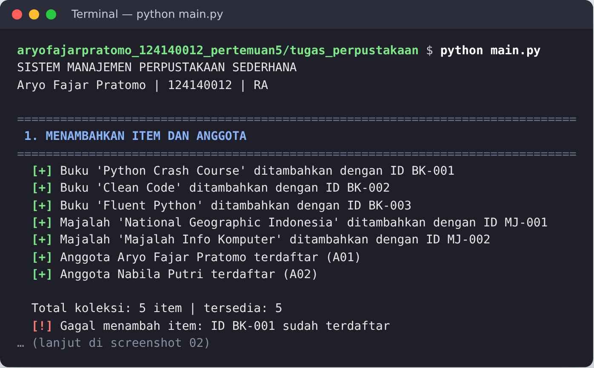
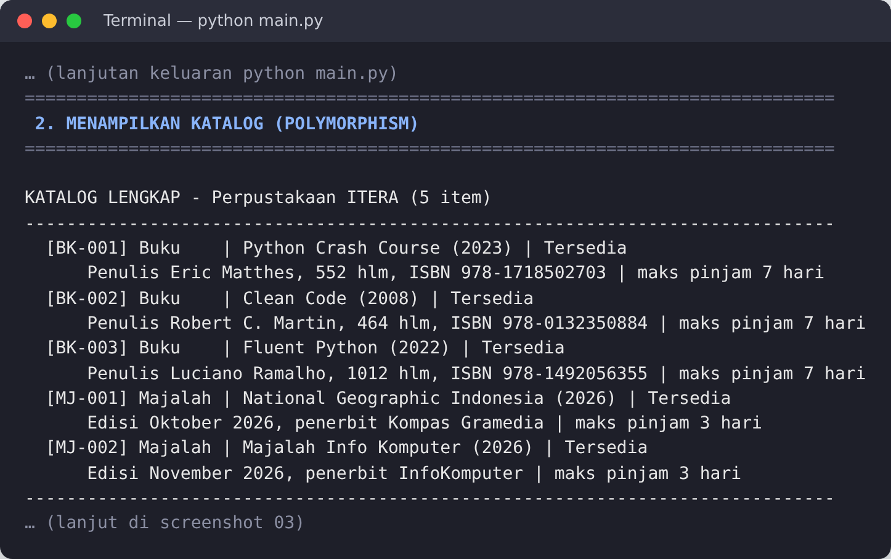
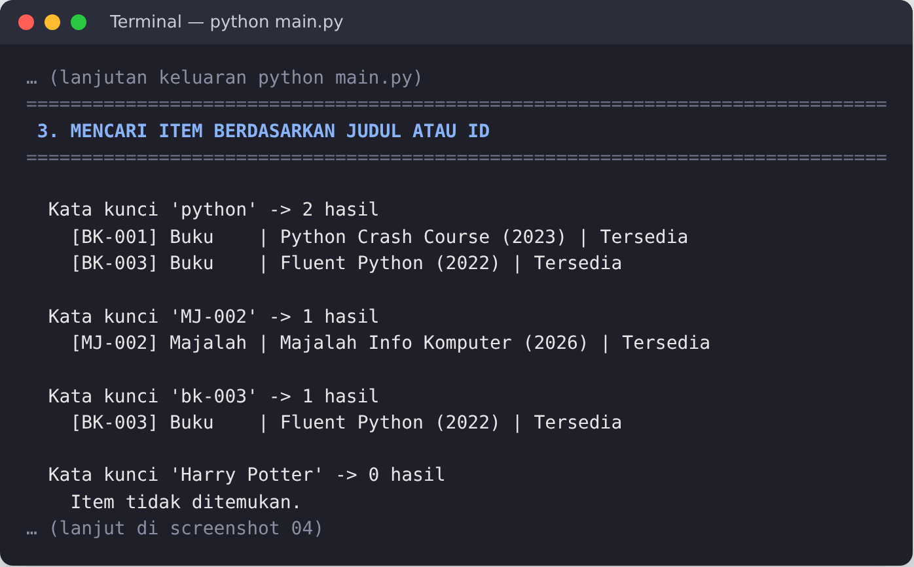
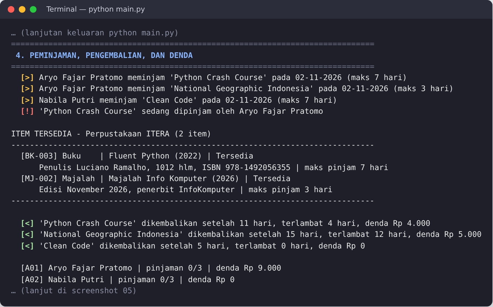
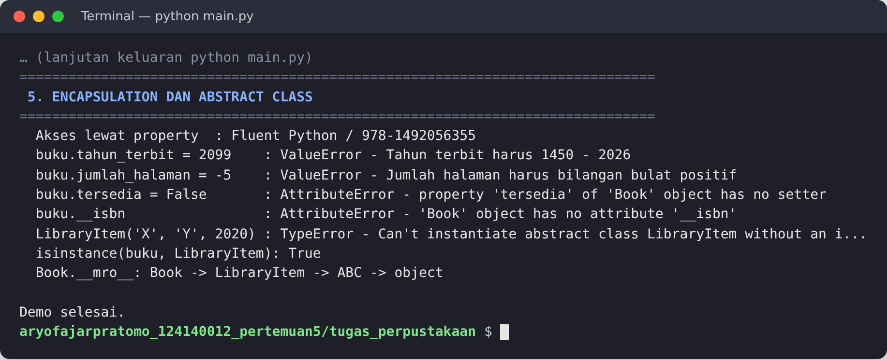
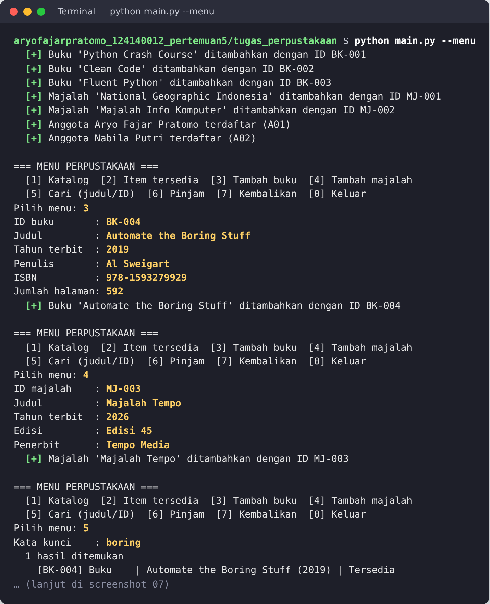
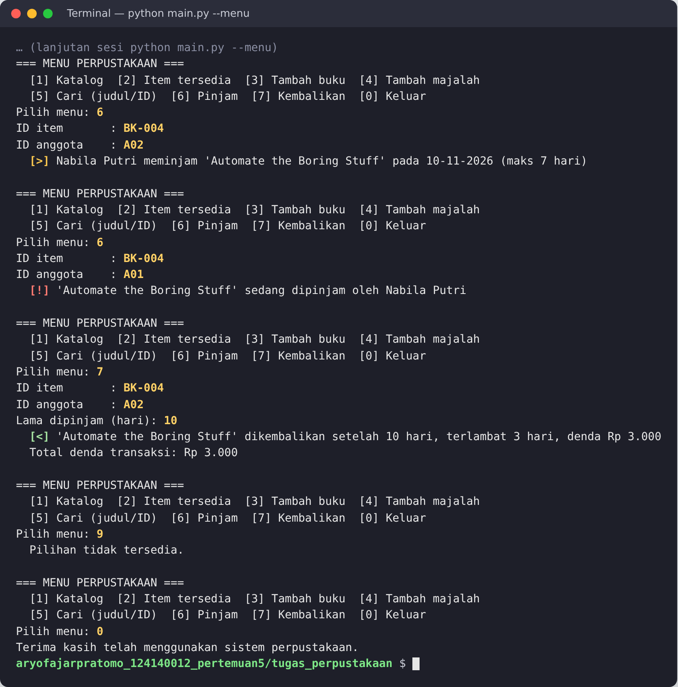
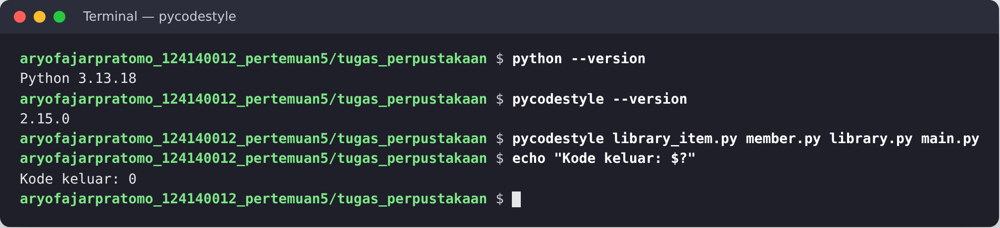

# Pertemuan 5 – Python OOP: Sistem Manajemen Perpustakaan Sederhana

## Identitas Mahasiswa

| | |
|---|---|
| **Nama Lengkap** | Aryo Fajar Pratomo |
| **NIM** | 124140012 |
| **Kelas Praktikum** | RA |
| **Mata Kuliah** | Pemrograman Aplikasi Web (PAW) 2026/2027 – Teknik Informatika ITERA |

## Struktur Folder

```
aryofajarpratomo_124140012_pertemuan5/
├── Modul/                          # kode hands-on & latihan mandiri dari modul
│   ├── 01_everything_is_object.py
│   ├── 01_procedural_vs_oop.py
│   ├── 02_class_object.py
│   ├── 03_inheritance.py
│   ├── 04_encapsulation.py
│   ├── 05_polymorphism.py
│   ├── 06_abstract_class.py
│   ├── latihan_toko_online.py
│   ├── latihan_buku.py
│   ├── latihan_truk.py
│   ├── latihan_karyawan.py
│   ├── latihan_notifikasi.py
│   ├── latihan_storage.py
│   └── README.md
├── tugas_perpustakaan/             # tugas praktikum
│   ├── library_item.py             # LibraryItem (ABC), Book, Magazine
│   ├── member.py                   # Member (anggota perpustakaan)
│   ├── library.py                  # Library (koleksi private __koleksi)
│   └── main.py                     # demo & menu interaktif
├── Screenshot/                     # bukti output terminal tugas (01–08)
├── README.md
└── .gitignore
```

## Deskripsi Program

Program ini adalah sistem manajemen perpustakaan sederhana berbasis terminal. Perpustakaan menyimpan dua jenis item, yaitu **buku** dan **majalah**, serta data **anggota**. Fitur yang tersedia:

1. **Menambahkan item** (buku/majalah) dan anggota; ID ganda ditolak.
2. **Menampilkan katalog**, baik seluruh koleksi maupun hanya item yang tersedia.
3. **Mencari item** berdasarkan ID (persis, tidak peka huruf besar/kecil) atau sebagian judul.
4. **Meminjam dan mengembalikan item** beserta perhitungan denda keterlambatan. Item yang sedang dipinjam tidak bisa dipinjam orang lain, dan setiap anggota maksimal meminjam 3 item.

Alur program: `main.py` membuat objek `Library`, mengisinya dengan beberapa `Book`, `Magazine`, dan `Member`, lalu menjalankan seluruh fitur secara berurutan (mode demo) atau melalui menu (mode interaktif).

### Penerapan Pilar OOP

| Pilar | Penerapan dalam kode |
|---|---|
| **Class & Object** | `LibraryItem`, `Book`, `Magazine`, `Member`, dan `Library` adalah class; setiap buku, majalah, dan anggota adalah objek. Dunder method `__str__`, `__repr__`, `__len__`, dan `__contains__` dipakai untuk menampilkan dan memeriksa objek. |
| **Abstraction** | `LibraryItem(ABC)` di `library_item.py` memiliki abstract property `jenis` dan abstract method `get_detail()`, `lama_pinjam()`, serta `hitung_denda()`. Class ini tidak bisa diinstansiasi langsung (`TypeError`). |
| **Inheritance** | `Book` dan `Magazine` mewarisi `LibraryItem` dan memanggil `super().__init__()`, sehingga atribut serta method umum (`pinjamkan()`, `kembalikan()`, `cocok_dengan()`, `__str__`) tidak ditulis ulang. |
| **Encapsulation** | Atribut protected (`_item_id`, `_judul`, `_tahun_terbit`) dan private (`__tersedia`, `__peminjam`, `__isbn`, `__koleksi`, `__anggota`, `__pinjaman`, `__total_denda`). Akses diatur melalui `@property`: `item_id` dan `tersedia` bersifat read-only, sedangkan `judul`, `tahun_terbit`, `jumlah_halaman`, dan `nama` memiliki setter dengan validasi. |
| **Polymorphism** | `Library.tampilkan_katalog()` dan `LibraryItem.kembalikan()` memanggil `get_detail()`, `lama_pinjam()`, dan `hitung_denda()` tanpa memeriksa jenis item. Hasilnya berbeda per subclass: **buku** dipinjam maksimal 7 hari dengan denda Rp 1.000/hari, sedangkan **majalah** maksimal 3 hari dengan denda Rp 500/hari (paling banyak Rp 5.000). |

## Panduan Menjalankan Program

Butuh Python 3.10 atau lebih baru, tanpa library tambahan.

```bash
cd aryofajarpratomo_124140012_pertemuan5/tugas_perpustakaan

# Mode demo: menjalankan seluruh fitur secara otomatis
python main.py

# Mode menu interaktif
python main.py --menu
```

Kode hands-on modul dijalankan dari folder `Modul`, misalnya `python 03_inheritance.py`.

## Screenshot Output

### 1. Menambahkan item dan anggota
Menambahkan 3 buku, 2 majalah, dan 2 anggota. Penambahan ID ganda (`BK-001`) ditolak.



### 2. Menampilkan katalog (polymorphism)
Satu perulangan memanggil `get_detail()` dan `lama_pinjam()`. Buku menampilkan penulis, jumlah halaman, dan ISBN, sedangkan majalah menampilkan edisi dan penerbit.



### 3. Mencari item berdasarkan judul atau ID
Pencarian `python` (sebagian judul), `MJ-002` dan `bk-003` (ID), serta kata kunci yang tidak ada.



### 4. Peminjaman, pengembalian, dan denda
Item yang sedang dipinjam tidak bisa dipinjam lagi dan hilang dari daftar item tersedia. Saat dikembalikan, buku yang terlambat 4 hari didenda Rp 4.000, sedangkan majalah yang terlambat 12 hari didenda Rp 5.000 karena dibatasi denda maksimum.



### 5. Encapsulation dan abstract class
Setter menolak nilai tidak valid, property read-only tidak bisa diubah, atribut private tidak bisa diakses langsung, dan `LibraryItem` tidak bisa diinstansiasi.



### 6–7. Menu interaktif
Menambah buku dan majalah baru, mencari, meminjam (termasuk pinjaman ganda yang ditolak), mengembalikan dengan denda, dan memilih menu yang tidak valid.




### 8. Pemeriksaan gaya kode PEP 8
`pycodestyle` tidak menemukan pelanggaran pada keempat berkas tugas.


